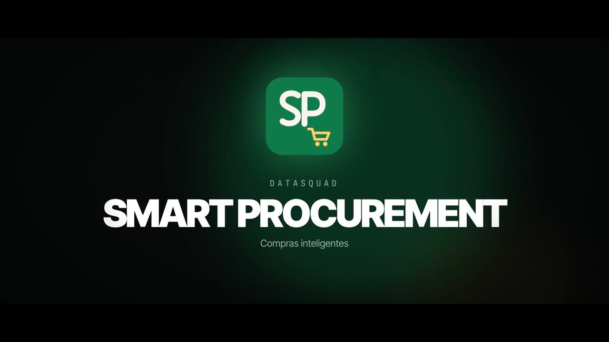
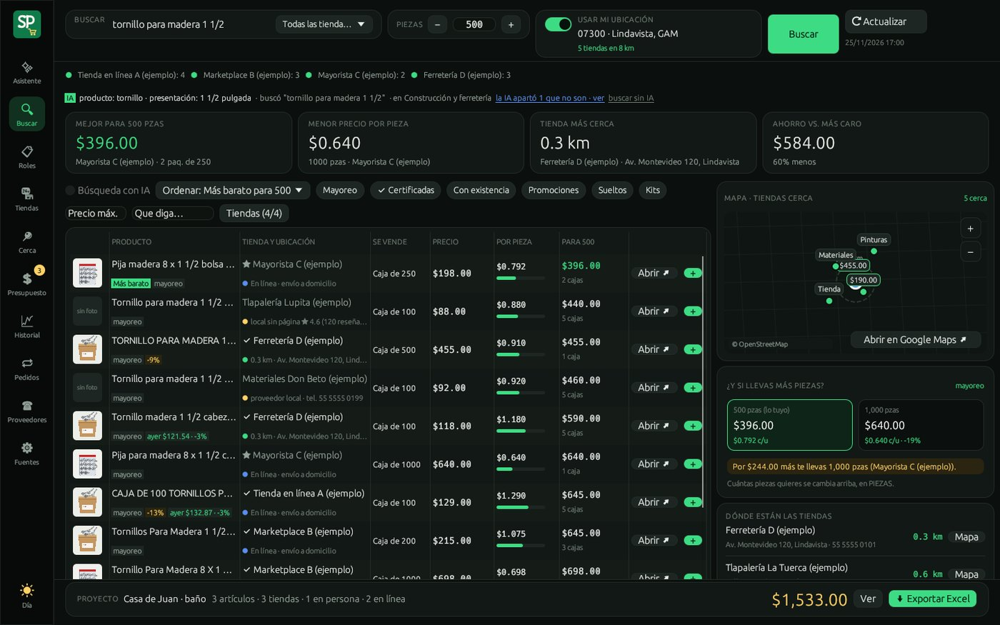
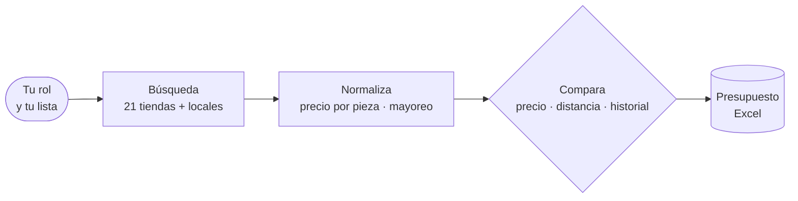
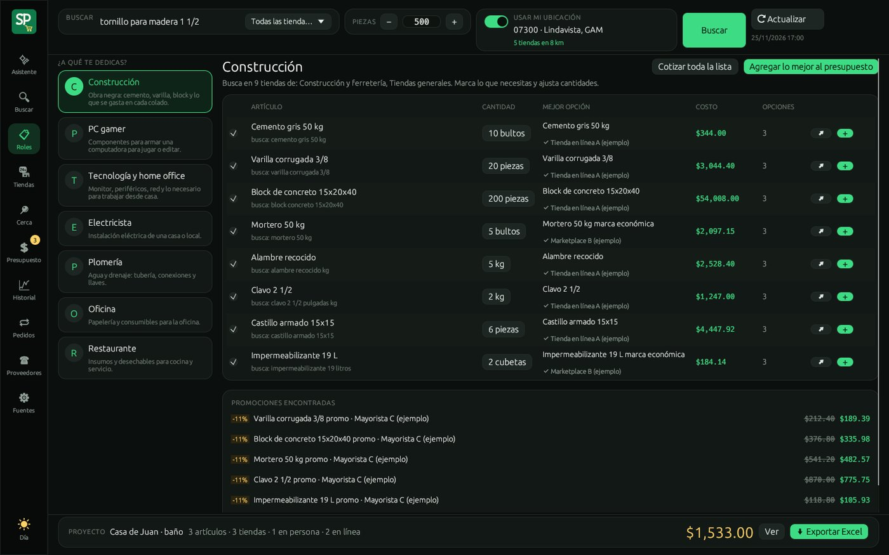
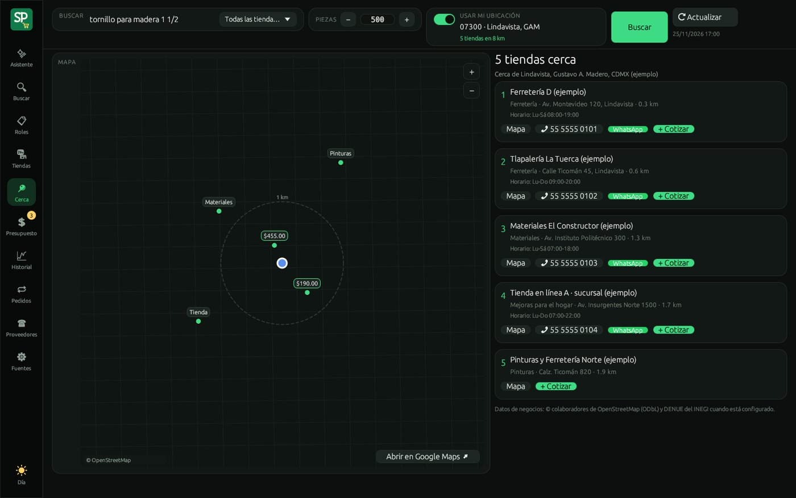
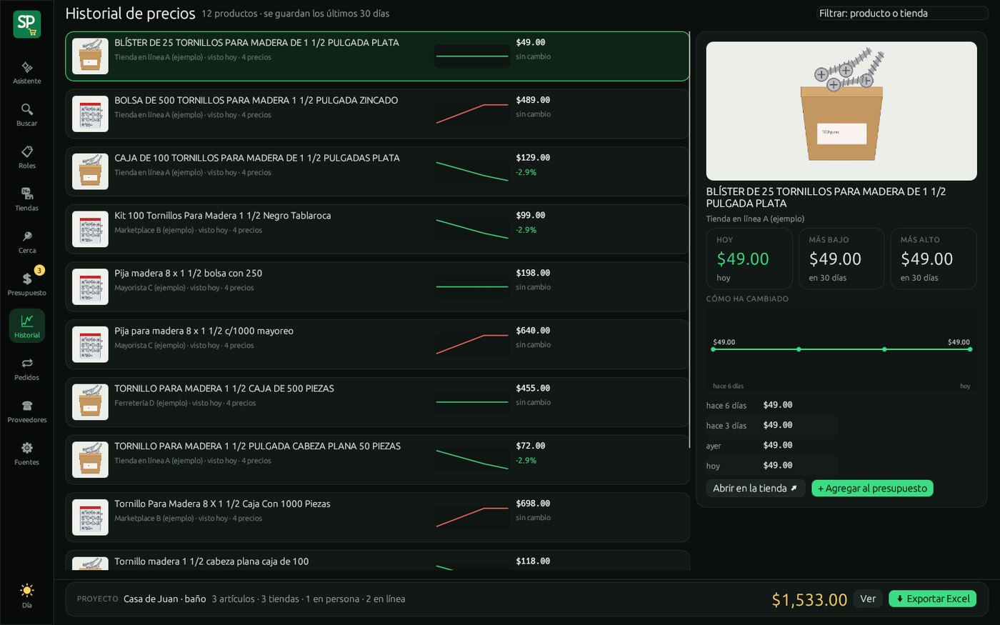
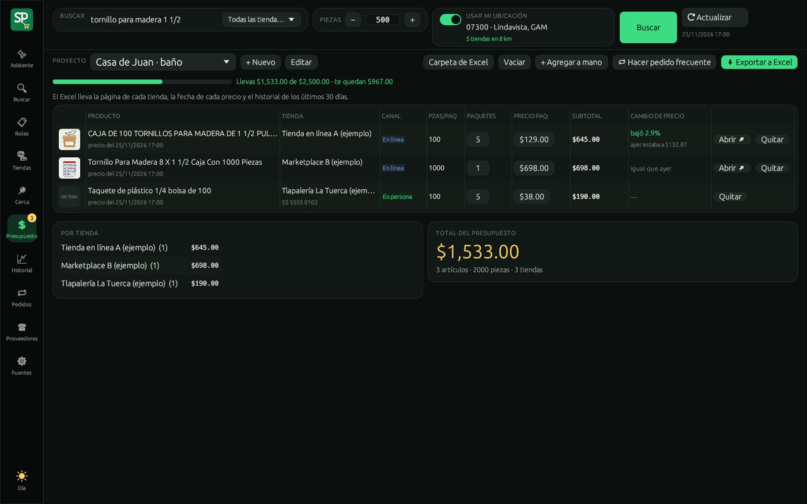
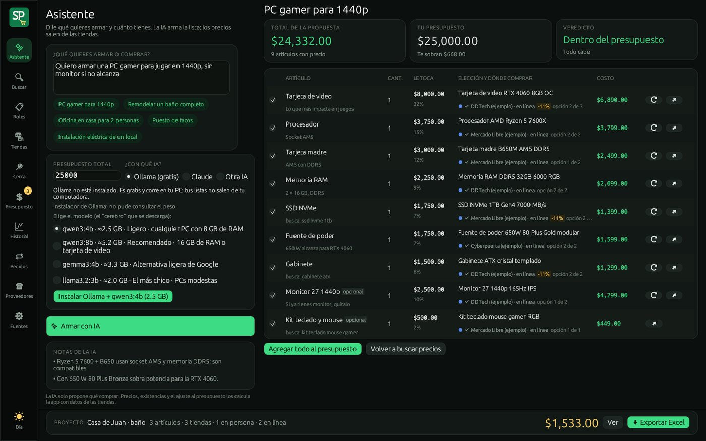
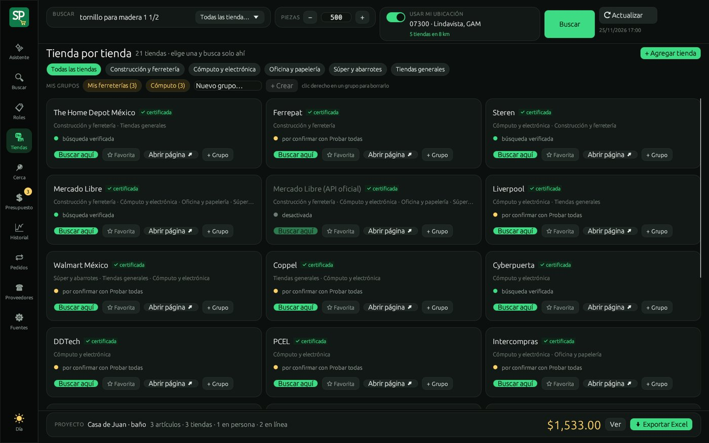

# DataSquad Smart Procurement

**Encuentra dónde conviene comprar cada cosa — y arma tu presupuesto en Excel.**
Busca un artículo en 21 tiendas y en los negocios cerca de ti, compara el precio real por pieza y decide.

[**Sitio web**](https://datasquad.pages.dev/smart-procurement/) ·
[**Descargar**](https://datasquad.pages.dev/smart-procurement/) ·
[**Ver la presentación**](https://datasquad.pages.dev/smart-procurement/) ·
[**Contacto**](mailto:datasquadoficial@gmail.com)

> [!NOTE]
> Este repositorio es la **ficha pública** de DataSquad Smart Procurement: explica qué es, cómo funciona y cómo obtenerlo.
> El código fuente es privado.

  
   Presentación de 51 segundos · clic para verla en el sitio

---

## ¿Qué es?

Smart Procurement es una **app de escritorio para cotizar compras**. Le dices a qué te dedicas y qué necesitas,
y busca cada artículo en tiendas en línea y en los negocios de tu zona. Compara el **precio por pieza**,
el **mayoreo** y las **promociones**, te muestra **qué tienes cerca** y arma el **presupuesto en Excel**.

## Funciones

| | |
|---|---|
| 🛒 **21 tiendas en línea** | Ferreterías, cómputo, papelería y autoservicio. Agrega tus propias tiendas con el botón *Probar*. |
| 📍 **Tiendas cerca de ti** | Mapa con negocios de tu zona, distancia, teléfono y WhatsApp (OpenStreetMap). |
| 👷 **Listas por rol** | Construcción, PC gamer, home office, electricista, plomería, oficina y restaurante. |
| 💲 **Precio real** | Lee el precio por pieza y de mayoreo; ignora mensualidades, “desde” y costos de envío. |
| 📈 **Historial de 30 días** | “Ayer estaba a $X”. El botón *Actualizar* vuelve a leer los precios. |
| 📊 **Presupuesto en Excel** | Proyectos con nombre y tope de gasto; el Excel guarda la liga y la fecha de cada precio. |
| 🤖 **Asistente con IA** | Dile qué quieres armar y tu presupuesto: la IA (Ollama local o Claude) hace la lista y la app la cotiza. |
| 🔁 **Pedidos frecuentes** | Favoritos que se cotizan solos y se envían por WhatsApp. |
| 📇 **Tus proveedores** | Pega la lista de precios que te mandan por WhatsApp, Excel o una foto. |
| 🔌 **Servidor MCP** | Úsala desde Claude Desktop: buscar, cotizar y armar el presupuesto por chat. |

## Cómo funciona

1. **Elige tu rol** o escribe lo que buscas.
2. **Busca** en todas las tiendas a la vez, o tienda por tienda.
3. **Compara**: lo más barato primero, con mayoreo, promociones e historial.
4. **Agrega al presupuesto** y expórtalo a Excel con las ligas de cada tienda.

## Capturas

<table>
  <tr>
    <td width="50%"> <b>Listas por rol</b> — cotiza toda la lista de tu oficio.</td>
    <td width="50%"> <b>Tiendas cerca</b> — distancia, teléfono y WhatsApp.</td>
  </tr>
  <tr>
    <td> <b>Historial</b> — 30 días de precios por artículo.</td>
    <td> <b>Presupuesto</b> — totales por tienda, listo para Excel.</td>
  </tr>
  <tr>
    <td> <b>Asistente IA</b> — arma una PC con tu presupuesto.</td>
    <td> <b>Tienda por tienda</b> — grupos, favoritas y tus propias tiendas.</td>
  </tr>
</table>
Capturas del modo de ejemplo: tiendas y precios ficticios.

## Herramientas MCP

| Herramienta | Qué hace |
|---|---|
| `buscar_producto` | Busca un artículo en las tiendas configuradas. |
| `cotizar_lista` | Cotiza una lista completa de artículos. |
| `tiendas_cerca` | Negocios cercanos a una ubicación. |
| `ver_presupuesto` | Muestra el presupuesto actual. |
| `agregar_al_presupuesto` | Agrega un artículo al presupuesto. |
| `listar_tiendas` | Lista las tiendas disponibles. |

## Calidad

- **208 pruebas automáticas**: lectura de precios, paquetes y piezas, búsqueda inteligente, lectores de tiendas, historial, Excel, proveedores, MCP y seguridad.
- Escrita en **Rust**: un solo ejecutable de ~13 MB, rápido y sin dependencias que instalar.

## Privacidad

- Tu presupuesto, tu ubicación y tus proveedores se guardan **solo en tu equipo**.
- La ubicación es aproximada y se activa con un interruptor.
- La IA es opcional; con Ollama corre completamente local.

## Requisitos

- Windows 10 u 11, 64 bits.
- Viene incluida en el **instalador de DataSquad** ([descargar](https://datasquad.pages.dev/suite/)).

## Aviso sobre las tiendas

Los nombres de las tiendas son marcas de sus respectivos dueños. DataSquad no está afiliado a ellas ni cuenta con su patrocinio;
la app solo consulta los precios que cada tienda publica en su página. Smart Procurement es una herramienta de uso personal.

## Colabora

¿Tienes una idea, encontraste un error o quieres sumarte? **Toda aportación cuenta**: las propuestas
se revisan, se platican y las que encajan entran en las próximas versiones — con crédito para quien las propuso.

- 💡 [Proponer una idea](../../issues/new?template=idea.yml)
- 🐞 [Reportar un error](../../issues/new?template=error.yml)
- 📧 Escríbenos a [datasquadoficial@gmail.com](mailto:datasquadoficial@gmail.com) para pruebas, alianzas o acceso al código.

Lee la [guía para colaborar](CONTRIBUTING.md).

### Colaboradores

Hecho con <a href="https://contrib.rocks">contrib.rocks</a>.

## Licencia

© 2026 DataSquad. Todos los derechos reservados. DataSquad Smart Procurement es software propietario;
este repositorio contiene solo documentación e imágenes del producto. Consulta [LICENSE](LICENSE).

Hecho en México por <a href="https://datasquad.pages.dev">DataSquad</a> · ¡El futuro se predice, con DataSquad se aprende!

